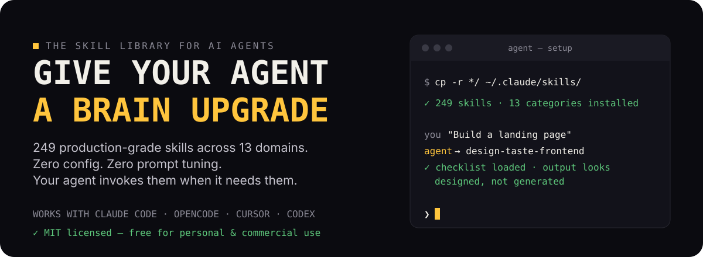
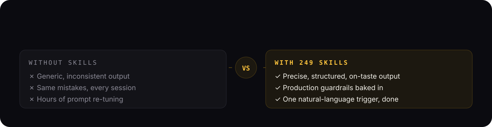
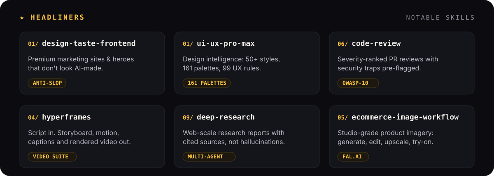

<p align="center">
  
</p>

<p align="center">
  <a href="https://github.com/ItWasYou-SAM/Skill-is-All-you-Need/stargazers"></a>
  
  
</p>

## Why it matters

<p align="center">
  
</p>

Your agent hallucinate-checks nothing and re-learns everything. **These 249 skills are the fix** — expert checklists your agent auto-loads at the moment it needs them. No config, no slash commands.

## The skills people reach for first

<p align="center">
  
</p>

…241 more across [13 categories](#the-full-library) · every skill indexed in [`COMMANDS.md`](./COMMANDS.md).

## Works like this

<p align="center">
  
</p>

## Set up in 30 seconds

```bash
git clone https://github.com/ItWasYou-SAM/Skill-is-All-you-Need.git
cp -r Skill-is-All-you-Need/* ~/.claude/skills/   # or ~/.agents/skills/ · .cursor/skills/
```

Then just ask — *“build a landing page”, “review this PR”, “make a launch video”* — the right skill loads itself.

## The full library

<p align="center">
  
</p>

<details>
<summary><strong>View all 13 categories</strong></summary>
<br>

| Category | Skills | What's inside |
| --- | ---: | --- |
| [01 · UI/UX Design](./01-ui-ux-design) | 45 | Anti-slop frontends, design systems, Figma, brand identity |
| [02 · Frontend Engineering](./02-frontend-engineering) | 23 | API design, 3D/WebGL, performance, testing, Next.js |
| [03 · Animation & Motion](./03-animation-motion) | 10 | GSAP ecosystem, scroll triggers, micro-interactions |
| [04 · Video Production](./04-video-production) | 22 | HyperFrames pipeline, captions, motion graphics, Remotion |
| [05 · Image & Media](./05-image-media) | 19 | fal.ai suite, generation & editing, upscaling, try-on |
| [06 · Code Quality](./06-code-quality) | 19 | Debugging, code review, TDD, hallucination detection |
| [07 · Development Workflow](./07-development-workflow) | 27 | Git, CI/CD, deployment, security, spec-driven dev |
| [08 · Agent & Skills](./08-agent-skills) | 41 | Skill creation, prompt engineering, parallel agents |
| [09 · Research & Analysis](./09-research-analysis) | 12 | Deep research, content analysis, audio generation |
| [10 · Document & Content](./10-document-content) | 15 | DOCX, PDF, PPTX, XLSX, changelogs |
| [11 · Brand & Marketing](./11-brand-marketing) | 12 | Social cards, ad extraction, resume generation |
| [12 · Business & Productivity](./12-business-productivity) | 4 | File organization, invoicing, developer growth |
| [13 · Reference & Tools](./13-reference-tools) | 5 | CLAUDE configs, Promptfoo, Shannon, MantisHub |

</details>

## Grab it & go

> 🚀 **Clone a category tonight** (see 30-second setup above) and compare your agent's output to yesterday's.
>
> ⭐ If it saves you a prompt-tuning session, star this repo — it tells us which skills to grow.

<details>
<summary><strong>Contributing & building blocks</strong></summary>
<br>

One skill, one job. Pass the rubric: **differentiation · reliability · specificity · operational value · token cost**.

Skill template: `name`, a *"Use this skill when…"* description, a 3–5 step process, and a defined output format. We review for quality, not quantity.

Built on [Claude Code](https://claude.ai), [Agent Skills](https://github.com/anthropics/agent-skills), [Open Design](https://github.com/nexu-io/open-design), [HyperFrames](https://github.com/heygen/hyperframes), [fal.ai](https://fal.ai), [GSAP](https://greensock.com), [Promptfoo](https://github.com/promptfoo), [Superpowers](https://github.com/superpowers), plus curated practices from Addy Osmani and Karpathy.

</details>

## License

[MIT](./LICENSE) — free for personal and commercial use.

<p align="center">
  <a href="https://github.com/oil-oil/beautify-github-readme"></a>
</p>
