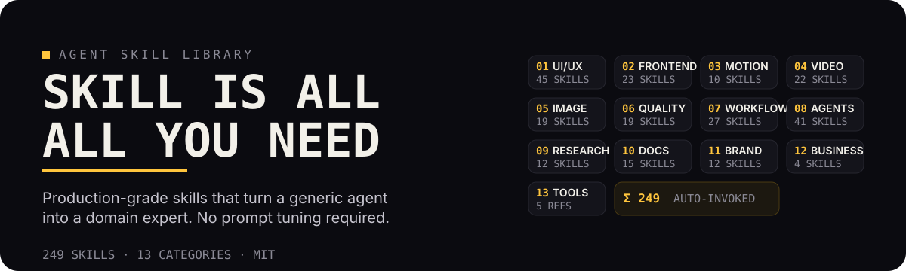
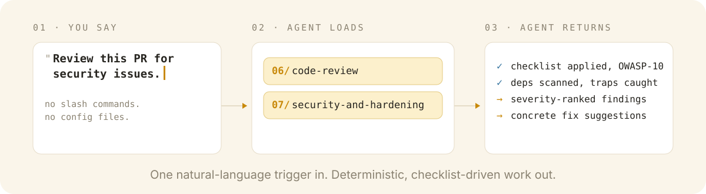

<p align="center">
  
</p>

<p align="center">
  <a href="https://github.com/ItWasYou-SAM/Skill-is-All-you-Need/stargazers"></a>
  <a href="https://github.com/ItWasYou-SAM/Skill-is-All-you-Need/network/members"></a>
  <a href="https://github.com/ItWasYou-SAM/Skill-is-All-you-Need/issues"></a>
  <a href="./LICENSE"></a>
</p>

> *Stop duct-taping workflows and re-explaining yourself to your agent. **Skill is All you Need** is a curated, battle-tested collection of 249 agent skills that turn a generic AI into a domain expert — whether you're designing UIs, debugging production fires, shipping video, or running a research pipeline.*

## Why

AI agents are powerful but unreliable without structure — they hallucinate, skip steps, and burn tokens on trial and error. A skill encodes expert knowledge into a focused, self-contained instruction set that your agent auto-loads exactly when it matters:

| Without skills | With skills |
| --- | --- |
| Generic output | Precise, structured output |
| Repeated mistakes | Encoded production guardrails |
| Prompt re-tuning every session | One natural-language trigger, done |

## Install

```bash
git clone https://github.com/ItWasYou-SAM/Skill-is-All-you-Need.git
cd Skill-is-All-you-Need
```

```bash
# Claude Code
cp -r */ ~/.claude/skills/          # excludes hidden dirs; skills live in numbered folders

# OpenCode
cp -r */ ~/.agents/skills/

# Cursor
cp -r */ .cursor/skills/

# Or cherry-pick a category
cp -r 06-code-quality/* ~/.claude/skills/
```

Then just ask naturally — the right skill is discovered and loaded automatically:

```text
"Build a landing page that doesn't look AI-generated"  →  design-taste-frontend
"Review this PR for security issues"                   →  code-review + security-and-hardening
"Debug this failing test"                              →  bug-debugging
"Create a product launch video"                        →  hyperframes
```

<p align="center">
  
</p>

## The Library

249 skills, 13 categories. Every skill is one job, one file, ready to invoke.

| Category | Skills | What's inside |
| --- | ---: | --- |
| [01 · UI/UX Design](./01-ui-ux-design) | 45 | Anti-slop frontends, design systems, Figma, color theory, brand identity |
| [02 · Frontend Engineering](./02-frontend-engineering) | 23 | API design, 3D/WebGL, performance, testing, Next.js |
| [03 · Animation & Motion](./03-animation-motion) | 10 | GSAP ecosystem, scroll triggers, micro-interactions, motion principles |
| [04 · Video Production](./04-video-production) | 22 | HyperFrames pipeline, captions, motion graphics, Remotion |
| [05 · Image & Media](./05-image-media) | 19 | fal.ai, image generation & editing, upscaling, 3D, virtual try-on |
| [06 · Code Quality](./06-code-quality) | 19 | Debugging, code review, TDD, verification, hallucination detection |
| [07 · Development Workflow](./07-development-workflow) | 27 | Git, CI/CD, deployment, security, spec-driven development |
| [08 · Agent & Skills](./08-agent-skills) | 41 | Skill creation, prompt engineering, context management, parallel agents |
| [09 · Research & Analysis](./09-research-analysis) | 12 | Deep research, content analysis, decision support |
| [10 · Document & Content](./10-document-content) | 15 | DOCX, PDF, PPTX, XLSX, changelogs, release notes |
| [11 · Brand & Marketing](./11-brand-marketing) | 12 | Social cards, ad extraction, resume generation |
| [12 · Business & Productivity](./12-business-productivity) | 4 | File organization, invoicing, developer growth |
| [13 · Reference & Tools](./13-reference-tools) | 5 | CLAUDE configs, Promptfoo, Shannon, MantisHub, Multica |

Prefer a command reference? See [`COMMANDS.md`](./COMMANDS.md) for every skill and trigger phrase in one file.

## Contributing

One skill, one job. Submit a PR with a skill that passes the five-part rubric: **differentiation, reliability, specificity, operational value, and token cost**. Quality over quantity.

<details>
<summary>Full contribution checklist</summary>

1. Read the skill template — `name`, a *"Use this skill when…"* description, a 3–5 step process, and a defined output format.
2. Keep it focused. If it does too much, split it.
3. Add trigger examples so the agent knows when to invoke it.
4. Test it against the 5-part rubric before submitting.
5. We review for quality, not quantity.

</details>

## Sources

Built on top of [Claude Code](https://claude.ai), [Agent Skills](https://github.com/anthropics/agent-skills), [Open Design](https://github.com/nexu-io/open-design), [HyperFrames](https://github.com/heygen/hyperframes), [fal.ai](https://fal.ai), [GSAP](https://greensock.com), [Promptfoo](https://github.com/promptfoo), [Superpowers](https://github.com/superpowers), and curated engineering practices from Addy Osmani and Karpathy.

## License

[MIT](./LICENSE) — use freely in personal and commercial projects.

<p align="center">
  <a href="https://github.com/oil-oil/beautify-github-readme"></a>
</p>
